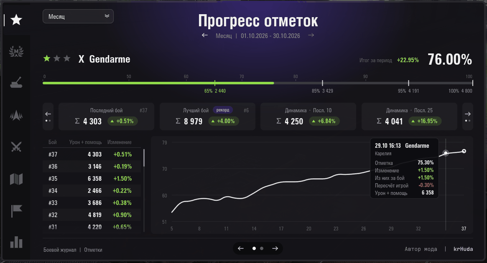
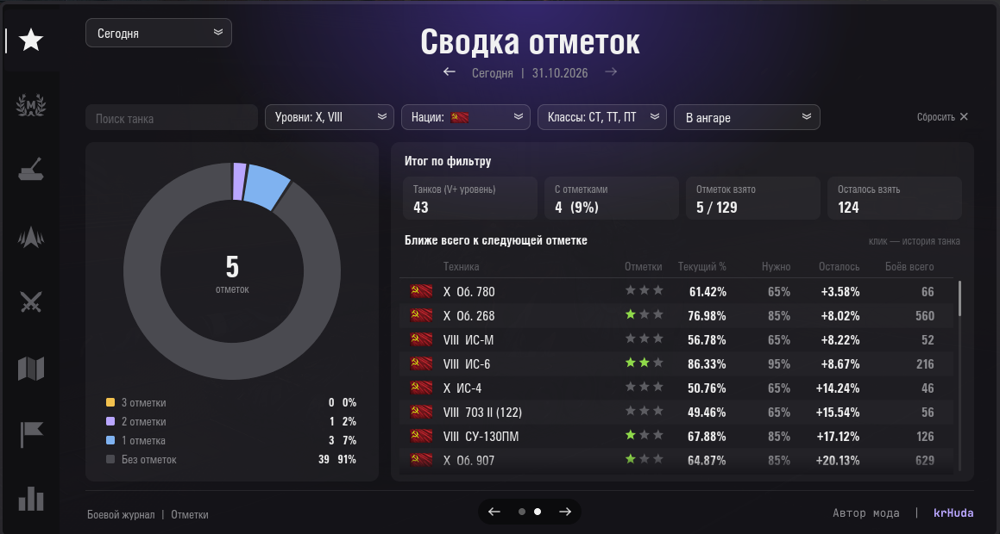
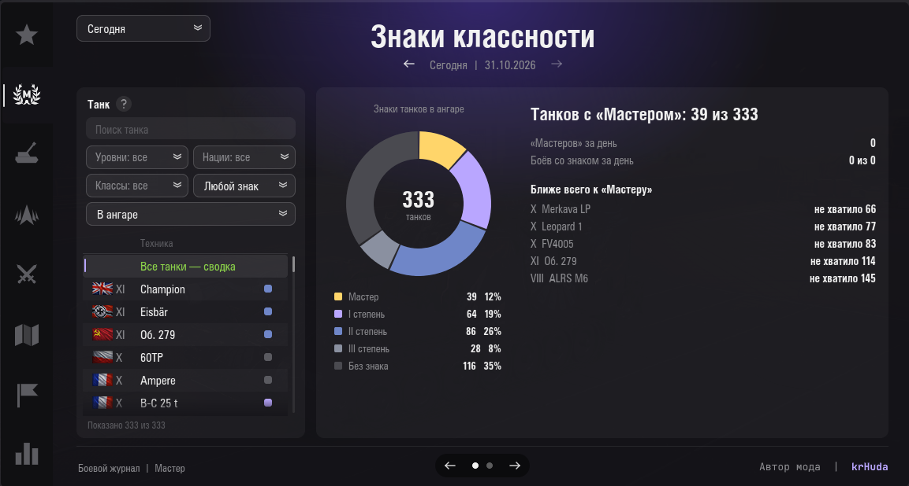
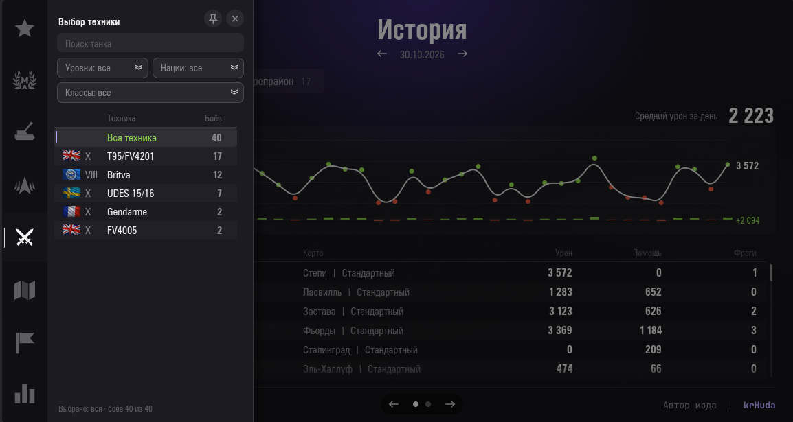
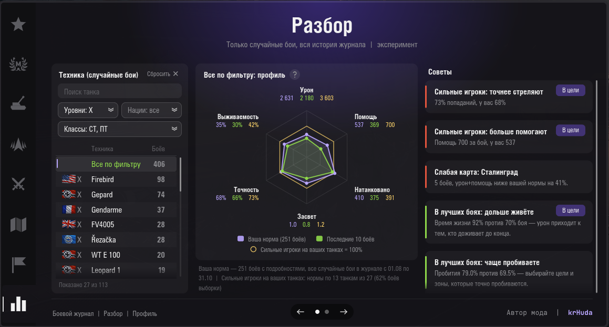
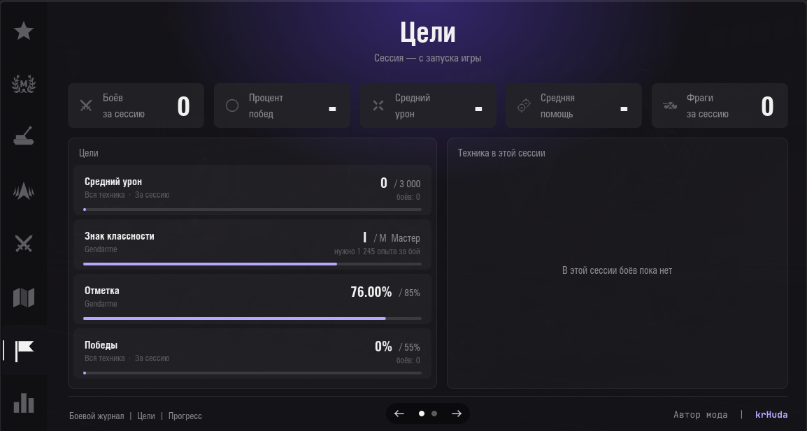
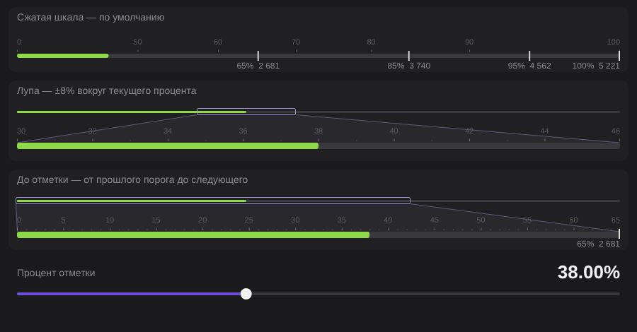

# Боевой журнал

Мод для «Мира танков». Ведёт журнал ваших боёв и показывает прогресс: отметки на стволе, урон от артиллерии, рейтинг Натиска, статистику по боям и картам, личные цели. Работает в ангаре (панель и большое окно) и в бою (компактная панель).

## Скриншоты

<table>
<tr>
<td align="center"> Прогресс отметок</td>
<td align="center"> Сводка отметок</td>
<td align="center"> «Мастер»</td>
</tr>
<tr>
<td align="center"> Бои: выбор техники</td>
<td align="center"> «Разбор»</td>
<td align="center"> Цели</td>
</tr>
<tr>
<td align="center" colspan="3">  Панели в ангаре и в бою</td>
</tr>
</table>

Картинки в таблице открываются в полном размере по клику.

## Установка

1. Скачайте файл `battlejournal_<версия>.mtmod` на странице [релизов](../../releases/latest).
2. Положите его в папку `<папка игры>\mods\<номер версии игры>\` - это папка с номером текущей версии клиента, например `mods\1.46.0.0\`. После обновления игры мод, как и другие моды, переносится в папку новой версии.
3. Запустите игру.

## Что умеет

**Отметки на стволе**
- текущий процент, пороги 65 / 85 / 95 / 100% в уроне с помощью;
- история изменений по боям, график, лучший и последний бой, динамика за 10 и 25 боёв;
- в окне - танк из ангара или выбранный в сводке; вторая страница - сводка по танкам: сколько танков с тремя, двумя, одной отметкой и без отметок, сколько отметок взято и сколько осталось, и танки, которым ближе всего до следующей отметки (клик - история танка); фильтр по названию, уровню, нации и классу, в ангаре или все на аккаунте;
- карточки порогов: сколько урона с помощью нужно для каждой отметки и сколько не хватает;
- в бою - прогноз процента «если бой закончится сейчас» и сколько урона с помощью нужно, чтобы не потерять процент;
- если процент изменился сильнее, чем можно ожидать от одного боя, подсказка покажет, сколько дал сам бой, а сколько - пересчёт: игра периодически обновляет пороги отметок по статистике всех игроков, и процент может сдвинуться даже без вашего боя.

Шкала прогресса - три вида на выбор в настройках: сжатая (по умолчанию: участок до 50% сжат, важная часть 50-100% растянута), «лупа» (±8% вокруг текущего процента) и «до отметки» (от прошлого порога до следующего). У «лупы» и «до отметки» сверху тонкая полная шкала с рамкой показанного участка. В бою можно показывать полную шкалу или только путь до следующей отметки.

**Артиллерия** - урон от САУ противника, попадания, накрытия, оглушения, повреждённые модули; в бою - отдельная вкладка, если у противника есть САУ.

**Натиск** - рейтинг, ранг, изменения по боям и картам.

**Мастер** (знаки классности) - слева выбор танка с фильтрами (название, уровни, нации флагами, классы, знак, в ангаре или все на аккаунте). По всем танкам - сколько каких знаков и где «Мастер» ближе всего; по танку - знаки в последних 10-100 боях или за период, пороги чистого опыта всех степеней и шкала с последним боем. Вторая страница - бои за период с полученным знаком.

**Бои** - история за день, 3 дня, неделю, месяц или всё время (урон, помощь, фраги, процент побед), рекорды. Дни и периоды листаются стрелками. Кнопка «Техника» открывает слева шторку с фильтрами и списком танков: история по одному танку или по всем танкам фильтра (шторку можно закрепить колонкой). Клик по точке графика за несколько дней открывает этот день со всеми боями.

**Карты** - на каких картах вы играете чаще и успешнее.

**Цели** - свои цели за сессию, день или последние N боёв: средний урон, помощь, натанкованный урон, засвет, фраги, точность, выживаемость, победы, число боёв, отметка, знак классности на танке (в бою - примерный прогноз знака при победе и поражении), рейтинг Натиска. Цели можно ставить прямо из советов «Разбора». Считаются по случайным боям; прогресс виден на панели в ангаре и в бою.

**Разбор** (эксперимент, по умолчанию выключен) - профиль игры на танке или на всех танках фильтра (лепестковая диаграмма: урон, помощь, натанкованный урон, засвет, точность, выживаемость): последние бои против вашей обычной игры, советы с кнопкой «В цели»; вторая страница - последние 30 боёв с оценкой и разбором выбранного. Сравнение с сильными игроками на том же танке - в разработке.

**Панели** - в ангаре и в бою панель можно свернуть в мини-панель (одна строка с главным значением) или спрятать до значка и вернуть обратно одним кликом - в том же размере. Замок закрепляет окно и панели на месте, у панели в бою есть свой замок. Панель в бою показывается в случайных боях и в Натиске.

**Путеводитель** - короткая экскурсия по окну мода: открывается при первом запуске и кнопкой «?». У кнопок окна и панели - всплывающие подсказки.

## Настройки

Шестерёнка справа от окна мода: какие вкладки показывать, вид панелей в ангаре и в бою, прозрачность и масштаб панели в бою, шрифт, начало игрового дня, восстановление удалённых боёв, выгрузка истории в CSV, перенос мода в новую версию игры (по умолчанию выключен: когда лаунчер заранее скачал обновление, мод копирует себя в папку новой версии), проверка новой версии мода и её скачивание по кнопке.

## Данные и приватность

- История боёв хранится только у вас на компьютере - в папке настроек игры, в подпапке `mods\battlejournal\`. Обычно это `%APPDATA%\Lesta\MirTankov\mods\battlejournal\`.
- Мод не использует сторонние сайты и веб-API - только данные, которые клиент игры получает сам (итоги боёв, досье, реплеи).
- В бою мод показывает только ваши собственные данные и не даёт никакой информации о противниках сверх обычного интерфейса.

## Если что-то не так

Опишите проблему и приложите `python.log` из папки игры. Для подробного лога откройте файл настроек мода `<папка игры>\mods\configs\battlejournal\config.json` и поменяйте `"debug": false` на `"debug": true`.

## Условия использования

- Мод бесплатный, для личного использования.
- Распространять мод можно только без изменений и со ссылкой на этот репозиторий.
- Изменять мод, выдавать его за свой и продавать запрещено.
- Мод распространяется «как есть», без гарантий. Мод не связан с компанией Lesta Games.
