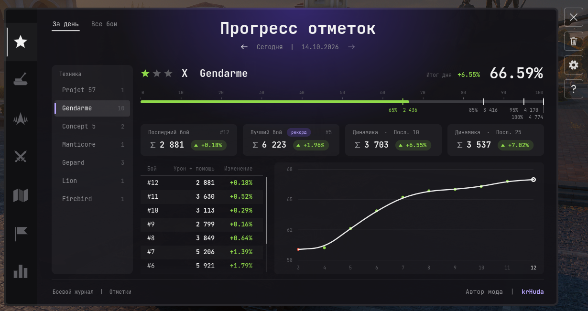
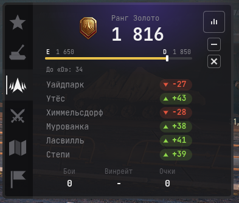
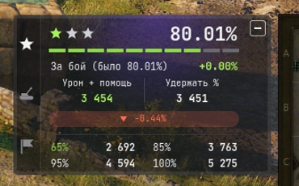

# Боевой журнал

Мод для «Мира танков». Ведёт журнал ваших боёв и показывает прогресс: отметки на стволе, урон от артиллерии, рейтинг Натиска, статистику по боям и картам, личные цели. Работает в ангаре (панель и большое окно) и в бою (компактная панель).

## Скриншоты

<b>Окно мода — прогресс отметок</b>

<b>Панель в ангаре</b>

<b>Панель в бою</b>

## Установка

1. Скачайте файл `battlejournal_<версия>.mtmod` на странице [релизов](../../releases/latest).
2. Положите его в папку `<папка игры>\mods\<номер версии игры>\` — это папка с номером текущей версии клиента, например `mods\1.45.0.0\`. После обновления игры мод, как и другие моды, переносится в папку новой версии.
3. Запустите игру.

## Что умеет

**Отметки на стволе**
- текущий процент, пороги 65 / 85 / 95 / 100% в уроне с помощью;
- история изменений по боям, график, лучший и последний бой, динамика за 10 и 25 боёв;
- в бою — прогноз процента «если бой закончится сейчас» и сколько урона с помощью нужно, чтобы не потерять процент;
- если процент изменился сильнее, чем можно ожидать от одного боя, подсказка покажет, сколько дал сам бой, а сколько — пересчёт: игра периодически обновляет пороги отметок по статистике всех игроков, и процент может сдвинуться даже без вашего боя.

**Артиллерия** — урон от САУ противника, попадания, накрытия, оглушения, повреждённые модули; в бою — отдельная вкладка, если у противника есть САУ.

**Натиск** — рейтинг, ранг, изменения по боям и картам.

**Бои** — история за день или за всё время (урон, помощь, фраги, процент побед), рекорды.

**Карты** — на каких картах вы играете чаще и успешнее.

**Цели** — свои цели (средний урон, победы, число боёв, отметка, рейтинг Натиска) за сессию, день или последние N боёв; прогресс виден на панели в ангаре и в бою.

**Разбор** (эксперимент, по умолчанию выключен) — оценка последних боёв, советы и сравнение со «сильными игроками» на том же танке. Сильный игрок — три отметки и не меньше 100 боёв на танке (для редких танков — две отметки, об этом есть пометка).

**Путеводитель** — короткая экскурсия по окну мода: открывается при первом запуске, кнопкой «?» и из настроек.

## Настройки

Шестерёнка справа от окна мода: какие вкладки показывать, вид панелей в ангаре и в бою, прозрачность и масштаб панели в бою, шрифт, начало игрового дня, восстановление удалённых боёв, выгрузка истории в CSV.

## Данные и приватность

- История боёв хранится только у вас на компьютере: `%APPDATA%\Lesta\MirTankov\mods\battlejournal\`.
- Мод не использует сторонние сайты и веб-API — только данные, которые клиент игры получает сам (итоги боёв, досье, реплеи).
- Сбор данных для сравнения с сильными игроками включается отдельно в настройках («Данные сильных игроков для «Разбора»»). Мод запрашивает профили игроков штатными запросами клиента — так же, как окно профиля игрока. В первые минуты загрузки FPS в ангаре может проседать.
- В бою мод показывает только ваши собственные данные и не даёт никакой информации о противниках сверх обычного интерфейса.

## Если что-то не так

Опишите проблему и приложите `python.log` из папки игры. Для подробного лога откройте файл настроек мода `<папка игры>\mods\configs\battlejournal\config.json` и поменяйте `"debug": false` на `"debug": true`.

## Условия использования

- Мод бесплатный, для личного использования.
- Распространять мод можно только без изменений и со ссылкой на этот репозиторий.
- Изменять мод, выдавать его за свой и продавать запрещено.
- Мод распространяется «как есть», без гарантий. Мод не связан с компанией Lesta Games.
